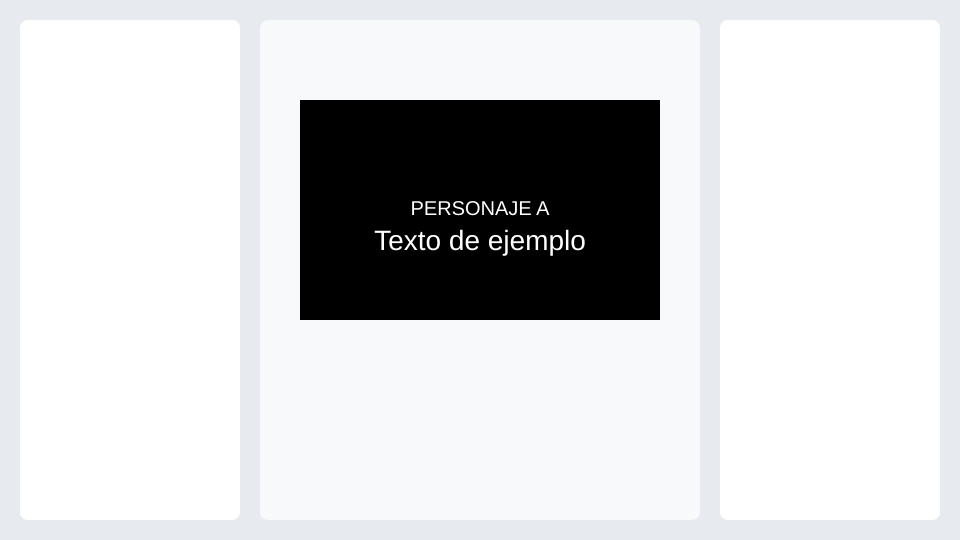

# TPG - Theater Prompt Generator

TPG es una aplicación web pública para convertir un libreto estructurado en diapositivas de proyección. Todo el procesamiento se realiza localmente en el navegador.



## Características

- Carga y validación de `obra.txt` y `config.yaml`.
- Previsualización de escenas, diálogos y pantallas negras.
- Editor visual de texto, fondos, tamaños, fuentes y personajes.
- Exportación independiente a PDF y PPTX.
- Navegación por teclado y controles de accesibilidad.
- Pruebas unitarias e integración de archivos de ejemplo.
- Sin backend, cuentas, servicios privados ni telemetría.

## Privacidad

Los archivos se leen mediante APIs del navegador y no se envían a servidores ni se guardan automáticamente. Las preferencias de interfaz pueden almacenarse en `localStorage`, pero el contenido del libreto no.

## Instalación y desarrollo

```bash
npm install
npm run dev
```

La aplicación estará disponible en la URL indicada por Vite.

```bash
npm run lint
npm run test
npm run build
npm run preview
```

## GitHub Pages

Vite usa `VITE_BASE_PATH` como base. Para despliegues bajo una ruta de GitHub Pages:

```bash
VITE_BASE_PATH=/nombre-del-repositorio/ npm run build
```

El workflow incluido ejecuta lint, pruebas y build y publica `dist` solo si todas las etapas terminan correctamente.

## Formato de obra.txt

```text
# ESCENA 1 | TÍTULO DE EJEMPLO

// Comentario interno

[PERSONAJE_A]
Primera línea de ejemplo.
Segunda línea de ejemplo.

[PERSONAJE_B]
Otro diálogo de ejemplo.

@BLACK
```

Un encabezado comienza con `# ESCENA`. Los personajes se escriben entre corchetes. `@BLACK` crea una página completamente negra. Consulte [FORMAT_SPEC.md](docs/FORMAT_SPEC.md).

## Formato de config.yaml

La configuración incluye metadatos, presentación, tipografía, personajes, cues y ajuste automático. El archivo de ejemplo está en [public/examples/config-ejemplo.yaml](public/examples/config-ejemplo.yaml).

## Limitaciones conocidas

La medición de texto depende de fuentes disponibles y de `CanvasRenderingContext2D.measureText`. Los límites son 5 MB para la obra, 1 MB para YAML y 10.000 cues. Los colores elegidos por el usuario pueden no alcanzar contraste AA.

## Atajos

- Flechas izquierda/derecha: navegar.
- Home/End: primer/último cue.
- B: siguiente pantalla negra.
- Ctrl/Cmd + Enter: abrir exportación.

## Licencia

Este proyecto se distribuye bajo **GNU Affero General Public License v3.0** (`AGPL-3.0-only`). El código puede utilizarse, estudiarse y modificarse; las redistribuciones deben conservar la licencia. Si se ofrece una versión modificada como servicio de red, el código fuente correspondiente debe ponerse a disposición de sus usuarios. El software se proporciona sin garantías.

Esta explicación no sustituye asesoría jurídica.
